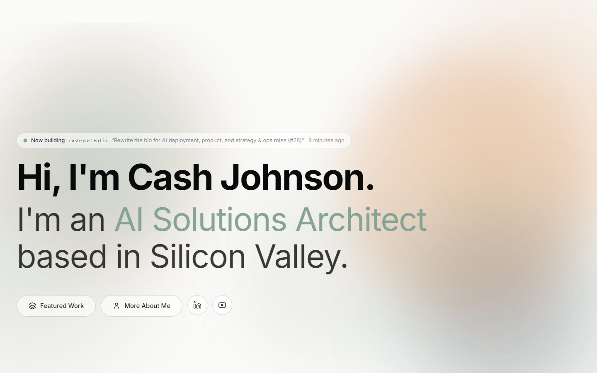
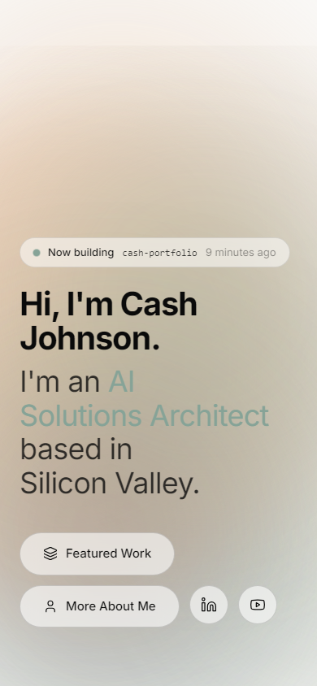
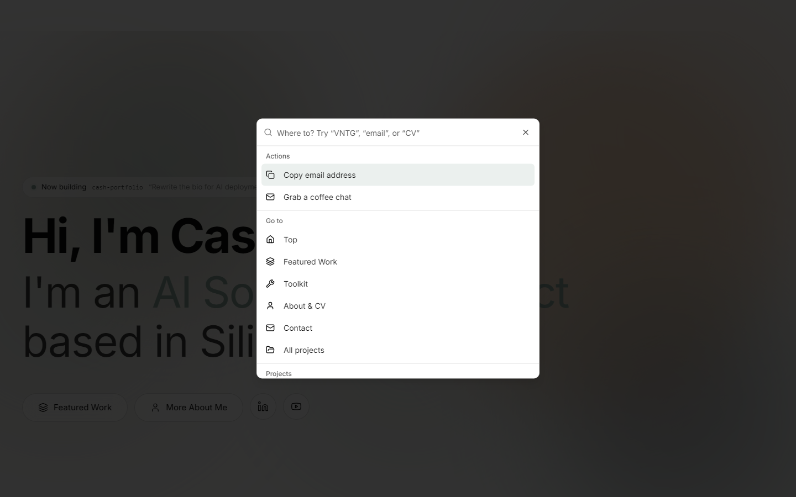
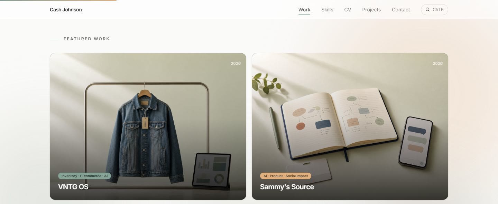
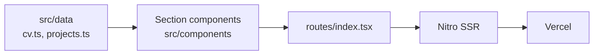

<div align="center">

# Cash Johnson — Portfolio

**Personal site, project index, CV, and operations blog. Server-rendered, edge-deployed, and built to be readable by recruiters and crawlers alike.**


[Live site](https://cashjohnson.net) · [Projects](https://cashjohnson.net/projects) · [Writing](#routes) · [LinkedIn](https://www.linkedin.com/in/cash-johnson/)

<br />



<br />
<br />

<table>
  <tr>
    <td align="center" width="50%">
      
    </td>
    <td align="center" width="50%">
      
    </td>
  </tr>
  <tr>
    <td align="center"><sub>Mobile</sub></td>
    <td align="center"><sub>Command palette</sub></td>
  </tr>
</table>

</div>

## Contents

- [Highlights](#highlights)
- [What This Is](#what-this-is)
- [Routes](#routes)
- [Architecture](#architecture)
- [Tech Stack](#tech-stack)
- [Components](#components)
- [Getting Started](#getting-started)
- [Deployment](#deployment)
- [SEO Notes](#seo-notes)

## Highlights

- **Recruiter-first layout.** Hero, stats strip, featured work, skills, and a CV timeline in the order a hiring manager scans.
- **Command palette.** Press `⌘K` or `Ctrl+K` to jump to sections, projects, and contact links from anywhere on the page.
- **Cursor-reactive hero aurora.** Gradient blobs in the hero drift and swirl with the pointer, driven by Framer Motion springs.
- **SSR and SEO.** Server-rendered with Nitro, plus `llms.txt`, a generated sitemap, `robots.txt`, and Open Graph images.
- **Real-user performance data.** Vercel Analytics and Speed Insights.
- **A few things hidden for the curious.** Poke around.

<div align="center">
  
</div>

## What This Is

A portfolio that does three jobs at once:

1. **Convert.** Hero, featured work, project index, and CV timeline arranged so a hiring manager finds the relevant proof in under thirty seconds.
2. **Rank.** Sitemap route, `robots.txt`, Open Graph imagery, and a hand-written `llms.txt` so both search engines and language models can describe the site accurately.
3. **Publish.** A small operations and project management blog, each post its own file-based route.

## Routes

| Route | Content |
|---|---|
| `/` | Hero, stats, featured work, skills, CV, contact |
| `/projects` | Full project index |
| `/blog/*` | Long-form posts: [`operations-and-project-management`](https://cashjohnson.net/blog/operations-and-project-management), [`operations-project-manager-role`](https://cashjohnson.net/blog/operations-project-manager-role), [`pm-vs-operations`](https://cashjohnson.net/blog/pm-vs-operations), [`how-to-document-sops`](https://cashjohnson.net/blog/how-to-document-sops) |
| `/sitemap.xml` | Generated server route |
| `/bikex` | BikeX team work board (static page in `public/bikex`) |
| `/forothers/job-tracker` | Job finder setup kit (static page in `public/forothers/job-tracker`) |

## Architecture



```text
.
├── src/
│   ├── routes/            File-based routes: home, projects, blog posts, sitemap
│   ├── components/        Page sections and shared UI
│   │   └── ui/            shadcn-style primitives (Radix + Tailwind)
│   ├── data/              CV and project content (cv.ts, projects.ts)
│   ├── assets/projects/   Project imagery
│   └── lib/site.ts        Contact links and shared constants
├── public/                llms.txt, robots.txt, OG images, static pages (bikex, forothers)
└── bot/                   BikeX Discord bot (separate Cloudflare Worker)
```

## Tech Stack

| Layer | Choice | Why |
|---|---|---|
| Framework | TanStack Start, TanStack Router 1.x | File-based routing with full type safety and SSR at the edge |
| UI | React 19, Tailwind CSS v4, Radix primitives, shadcn-style components | Modern rendering, zero-config styling pipeline |
| Motion | Framer Motion 12 | Aurora background and section transitions |
| Server | Nitro on Vercel | SSR on Vercel's network, with a production deploy on every merge to `main` |
| Analytics | Vercel Analytics, Speed Insights | Real-user performance and traffic data |
| Tooling | Vite 7, ESLint 9, Prettier, TypeScript 5.8 | Fast builds, enforced formatting |

## Components

Every section of the home page lives in `src/components`. Content is in `src/data/*.ts`; contact and profile links are in `src/lib/site.ts`.

| Component | Role |
|---|---|
| `Navbar` | Top navigation and mobile menu |
| `HeroSection` | Above-the-fold positioning statement, contact actions, and the cursor-reactive aurora |
| `NowBuilding` | Latest GitHub activity, shown inside the hero |
| `StatsStrip` | Headline numbers directly under the hero |
| `ProjectsSection` | Card grid backed by `src/data/projects.ts` and `src/assets/projects` |
| `SkillsSection` | Toolkit and skills |
| `CVSection` | Experience and education timeline, backed by `src/data/cv.ts` |
| `Footer` | Contact and closing links |
| `CommandPalette` | `⌘K` / `Ctrl+K` quick navigation |
| `ScrollProgress` | Page scroll indicator |
| `AuroraBackground` | Slow, CSS-animated gradient backdrop behind the whole page |

## Getting Started

**Prerequisites:** [Bun](https://bun.sh), or Node 20+ with npm.

```sh
git clone https://github.com/Shacxify/cash-portfolio.git
cd cash-portfolio
bun install     # or: npm install
bun run dev
```

| Script | Purpose |
|---|---|
| `dev` | Vite dev server |
| `build` | Production build |
| `build:dev` | Development-mode build |
| `preview` | Serve the production build locally |
| `lint` | ESLint 9 flat config |
| `format` | Prettier write across the repo |

## Deployment

Vercel deploys automatically from GitHub. Every merge to `main` ships to production at [cashjohnson.net](https://cashjohnson.net), and every pushed branch gets a preview deployment. There is no manual deploy step.

<details>
<summary>Repo notes</summary>

- `wrangler.jsonc` is left over from the earlier Cloudflare Workers setup and is not used by production.
- [`bot/`](bot/README.md) holds the BikeX Discord bot, a scheduled Cloudflare Worker that reads the BikeX board and posts reminders to Discord.

</details>

## SEO Notes

- `public/llms.txt` gives language models a structured summary of the site instead of leaving them to guess.
- `public/robots.txt` and the generated `/sitemap.xml` route keep crawl paths explicit.
- `public/og-home.jpg` and per-post imagery in `public/blog` control link previews across social and messaging platforms.

<div align="center">

---

[cashjohnson.net](https://cashjohnson.net) · [LinkedIn](https://www.linkedin.com/in/cash-johnson/) · [YouTube](https://www.youtube.com/@Cash-Johnson) · [me@cashjohnson.net](mailto:me@cashjohnson.net)

</div>
